# ashishkumar<!-- Top Section: Koi and Bonsai -->

 

<!-- Bottom Section: Stats Cards (Light/Dark Mode Aware) -->
<a href="https://github.com/ashishkumar0724#year-list-container">
  <picture>
    <source media="(prefers-color-scheme: dark)" srcset="cards/stats-dark.svg">
    
  </picture>
</a>

<a href="https://github.com/ashishkumar0724?tab=repositories">
  <picture>
    <source media="(prefers-color-scheme: dark)" srcset="cards/languages-dark.svg">
    
  </picture>
</a>
 

### Hi there, I'm Ashish Kumar 👋

I'm a developer passionate about building practical, technology-driven solutions. My recent work focuses on **Python**, **Machine Learning**, and **RAG (Retrieval-Augmented Generation)** systems, alongside interactive web experiences.

- 🔭 I’m currently working on: RAG-based chat applications and AI-powered database interfaces (like [`askmydb-mysql`](https://github.com/ashishkumar0724/askmydb-mysql)).
- 🌱 I’m currently learning: Advanced MLOps pipelines, drift detection, and scalable AI deployment.
- 💬 Ask me about: Python, Streamlit, LLM integrations, and building developer-friendly tools.
- 📫 How to reach me: [Add your email or LinkedIn here]

---